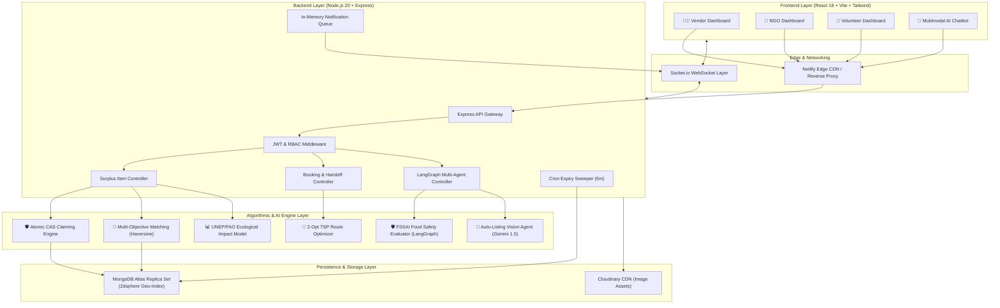
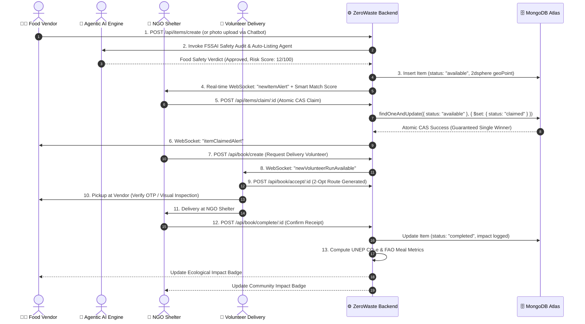
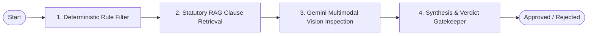

# 🌍 ZeroWaste: End-to-End Technical & Architectural Documentation

---

## 📖 Executive Summary

**ZeroWaste** is an enterprise-grade, real-time surplus food redistribution ecosystem designed to bridge the structural divide between commercial food donors (*restaurants, bakeries, corporate cafeterias, caterers, hotels*) and hunger-relief organizations (*NGO community shelters, orphanages, food banks*), facilitated by a dedicated network of *volunteer delivery partners*.

Unlike conventional CRUD donation apps, ZeroWaste operates as an **algorithmic and agentic logistics platform**. It solves the critical failure points of perishable food rescue:
1. **Perishability & Safety**: Food degrades rapidly; human consumption must comply with statutory safety envelopes (FSSAI 2019 guidelines).
2. **Concurrency & Double-Claiming**: Multiple shelters competing for high-value food batches must never trigger double-allocation.
3. **Logistics & Fragmentation**: Volunteers traveling across cities need optimal multi-stop routing to conserve time and fuel.
4. **Information Asymmetry**: Manual listing is slow; AI vision agents automatically inspect, categorize, and list food from photos in seconds.
5. **Auditable ESG & Ecological Accounting**: Every rescue translates into verified UNEP greenhouse gas reductions (CO₂e) and FAO meal allocations.

---

## 🏛️ System Architecture



---

## 👥 Stakeholder Roles & Real-Time Lifecycle



---

## 🧠 Core Algorithmic & Agentic Engines

### 1. 🛡️ Atomic Compare-and-Swap (CAS) Claiming Engine
* **File:** [`backend/controller/item.controller.js`](file:///c:/Users/ishan/Desktop/all/myzerowaste/backend/controller/item.controller.js)
* **Problem:** In high-density urban areas, multiple NGOs may browse and click "Claim" on the same 50-meal batch of fresh cooked food simultaneously. Naive `find-then-update` causes write-skew race conditions, resulting in duplicate claims and wasted logistical trips.
* **Mechanism:**
  ```javascript
  const claimedItem = await Item.findOneAndUpdate(
    {
      _id: itemID,
      status: "available",
      $or: [{ claimedBy: null }, { claimedBy: { $exists: false } }]
    },
    {
      $set: {
        status: "claimed",
        claimedBy: req.user.userId,
        claimStatus: "pending",
        claimedAt: new Date(),
      }
    },
    { new: true }
  );
  ```
* **Guarantee:** The MongoDB WiredTiger storage engine locks the specific document record at memory-page level. Exactly one operation mutates the document from `"available"` to `"claimed"`. Subsequent operations evaluate `{ status: "available" }` as false, immediately receive `null`, and return **HTTP 409 Conflict** with error code `RACE_CONDITION_CLAIM_CONFLICT`.

---

### 2. 🧠 Multi-Criteria Smart Matching Engine
* **File:** [`backend/services/matchingService.js`](file:///c:/Users/ishan/Desktop/all/myzerowaste/backend/services/matchingService.js)
* **Goal:** Rank and recommend donations to NGOs based on holistic operational compatibility rather than simple chronological order.
* **Mathematical Formulation:**

$$\text{Composite Match Score} = w_p \cdot S_{\text{proximity}} + w_u \cdot S_{\text{urgency}} + w_c \cdot S_{\text{capacity}} + w_d \cdot S_{\text{dietary}} + w_r \cdot S_{\text{reliability}}$$

* **Weights Configuration:**
  - Spatial Proximity ($w_p = 0.30$)
  - Expiry Urgency ($w_u = 0.30$)
  - Shelter Capacity Match ($w_c = 0.15$)
  - Dietary Alignment ($w_d = 0.15$)
  - Vendor Reliability Rating ($w_r = 0.10$)

* **Metric Definitions:**
  1. **Haversine Distance Decay ($S_{\text{proximity}}$):**
     $$d = 2 R \arcsin\left(\sqrt{\sin^2\left(\frac{\Delta\phi}{2}\right) + \cos(\phi_1)\cos(\phi_2)\sin^2\left(\frac{\Delta\lambda}{2}\right)}\right)$$
     $$S_{\text{proximity}} = 100 \cdot e^{-d / 7\text{ km}}$$
  2. **Perishability Step Curve ($S_{\text{urgency}}$):**
     - Remaining shelf life $\le 3\text{h} \implies 100/100$ (Critical Rescue Window)
     - Remaining shelf life $\le 6\text{h} \implies 85/100$
     - Remaining shelf life $\le 12\text{h} \implies 70/100$
     - Remaining shelf life $\le 24\text{h} \implies 50/100$
  3. **Strict Dietary Filter ($S_{\text{dietary}}$):**
     - Pure Vegetarian Shelter receiving Non-Vegetarian food $\implies 0/100$ (Hard Penalty / Filter)
     - Exact Match $\implies 100/100$
     - Universal Shelter $\implies 80/100$
  4. **Capacity Match ($S_{\text{capacity}}$):**
     - Evaluates $\text{batch size} / \text{shelter capacity}$. Optimal ratio ($0.8 - 1.2$) achieves $100\%$, avoiding both underfeeding and secondary spoilage.

---

### 3. 🚴 2-Opt TSP Volunteer Route Optimizer
* **File:** [`backend/services/routeOptimizer.js`](file:///c:/Users/ishan/Desktop/all/myzerowaste/backend/services/routeOptimizer.js)
* **Goal:** A volunteer assigned to collect multiple donations across several food donors before delivering them to a shelter must not take an inefficient zigzag route.
* **Algorithm:**
  1. **Distance Matrix Formulation:** Calculates pairwise Haversine distances across all stops: $[\text{Start}, P_1, P_2, \dots, P_n, \text{End}]$.
  2. **Nearest-Neighbor Heuristic:** Generates a fast, greedy baseline sequence starting from the volunteer's current GPS location.
  3. **2-Opt Edge Inversion (Local Search):**
     Iteratively identifies crossing paths $(u_i, u_{i+1})$ and $(u_k, u_{k+1})$. If reversing the sub-segment between $i+1$ and $k$ reduces overall Euclidean/Haversine cost, the tour is inverted:
     $$\Delta D = (\text{dist}(i, k) + \text{dist}(i+1, k+1)) - (\text{dist}(i, i+1) + \text{dist}(k, k+1))$$
     When $\Delta D < 0$, the edge exchange is committed until local convergence is reached.

---

### 4. 🛡️ Agentic FSSAI Food Safety Evaluator (LangGraph + Gemini Vision)
* **File:** [`backend/services/foodSafetyAgent.js`](file:///c:/Users/ishan/Desktop/all/myzerowaste/backend/services/foodSafetyAgent.js)
* **Compliance Basis:** Food Safety and Standards Authority of India (FSSAI) *Surplus Food Redistribution Regulations, 2019*.
* **StateGraph Topology:**



* **Pipeline Nodes:**
  - **Node 1: Deterministic Filter**: Enforces hard physics constraints:
    * Ambient perishable food $> 4\text{ hours}$ old $\implies \text{Instant Critical Risk (Score: 92/100)}$.
    * Ambient non-veg food $> 2.5\text{ hours}$ old $\implies \text{Instant Critical Risk (Score: 95/100)}$.
  - **Node 2: Semantic Clause Retrieval**: Matches item category against embedded regulatory provisions (Temperature control 4(2), Biological risk 5(2), Packaging hygiene 6, Low moisture produce 7).
  - **Node 3: Gemini Vision Inspection**: Inspects uploaded food photos for discoloration, bubbling/fermentation, broken seal containers, mold spores, or improper open-air handling.
  - **Node 4: Verdict Gatekeeper**: If Risk Score $< 35 \implies$ **APPROVED**; if $35-65 \implies$ **APPROVED WITH CONDITIONAL DISPATCH** (e.g., Expedited 45m courier in insulated hot bag); if $> 65 \implies$ **REJECTED** from human distribution.

---

### 5. 📸 Multimodal Auto-Listing Vision Agent
* **File:** [`backend/services/autoListingAgent.js`](file:///c:/Users/ishan/Desktop/all/myzerowaste/backend/services/autoListingAgent.js)
* **Functionality:** Eliminates manual data entry for busy kitchen staff. The vendor takes a smartphone photo of leftover trays.
* **Inference Pipeline:**
  - Passes the image buffer to Google Gemini 1.5 Flash with structured JSON schema output instructions.
  - Automatically extracts:
    * `title`: Canonical dish name (e.g., *"Assorted Fresh Paneer Butter Masala & Steamed Basmati Rice"*).
    * `category`: `Cooked Meals`, `Bakery & Pastry`, `Raw Produce`, or `Dairy`.
    * `foodType`: `veg` or `non-veg`.
    * `quantity`: Estimated quantity in kilograms and standard meal portions.
    * `storageCondition`: Recommended holding state (`ambient`, `chilled`, `heated`).
    * `remainingHours`: Safe shelf-life window computed from visual and thermal cues.

---

### 6. 📊 UNEP & FAO Ecological Impact Calculator
* **File:** [`backend/services/impactService.js`](file:///c:/Users/ishan/Desktop/all/myzerowaste/backend/services/impactService.js)
* **Standard Scientific Coefficients:**
  - **CO₂e Emissions Averted:** UNEP Food Waste Index Standard $\implies 2.50\text{ kg CO}_2\text{e} \text{ avoided per kg food}$.
  - **Nutritional Meal Equivalency:** FAO / Global FoodBanking Network Benchmark $\implies 0.42\text{ kg food} = 1\text{ nutritious meal}$.
  - **Embedded Agricultural Freshwater Conserved:** Water Footprint Network Benchmark $\implies 1,000\text{ Liters conserved per kg food}$.

---

## 🗄️ Database Architecture & Schemas

ZeroWaste uses **MongoDB Atlas** with geospatial and relational indexing:

### 1. `users` Collection
| Field | Type | Attributes | Description |
| :--- | :--- | :--- | :--- |
| `_id` | ObjectId | Primary Key | Unique user identifier |
| `name` | String | Required | Full name of contact person |
| `email` | String | Required, Unique, Indexed | Authentication identity |
| `password` | String | Required | Salted bcrypt hash ($10$ rounds) |
| `role` | String | Enum: `vendor`, `ngo`, `volunteer`, `admin` | System authorization role |
| `organisation`| String | Optional | Commercial or NGO registered entity name |
| `location` | String | Required | Human-readable address string |
| `geoPoint` | GeoJSON Point | Index: `2dsphere` | `[longitude, latitude]` coordinates |
| `capacity` | Number | Default: `50` | Maximum meal distribution capacity (NGO) |
| `dietPreference` | String | Enum: `veg`, `non-veg`, `all` | Feeding constraint profile |
| `averageRating`| Number | Default: `4.5` | Composite historical reliability score |

### 2. `items` Collection
| Field | Type | Attributes | Description |
| :--- | :--- | :--- | :--- |
| `_id` | ObjectId | Primary Key | Surplus food batch ID |
| `vendor` | ObjectId | Ref: `User`, Indexed | Donor vendor foreign key |
| `title` | String | Required | Descriptive listing name |
| `foodType` | String | Enum: `veg`, `non-veg` | Dietary classification |
| `category` | String | Default: `"Food"` | Dish classification |
| `quantity` | Number | Required | Net weight in kilograms |
| `expiryDate` | Date | Required, Indexed | Safe consumption deadline |
| `status` | String | Enum: `available`, `claimed`, `completed`, `expired` | Lifecycle state |
| `claimedBy` | ObjectId | Ref: `User`, Nullable | Claiming NGO ID |
| `geoPoint` | GeoJSON Point | Index: `2dsphere` | Physical pickup location coordinates |
| `foodSafetyAudit` | Object | Subdocument | FSSAI risk score, verdict, timestamp |
| `co2SavedKg` | Number | Computed | Accumulated greenhouse emission savings |
| `mealsServed` | Number | Computed | Accumulated meal equivalents |

### 3. `bookings` Collection
| Field | Type | Attributes | Description |
| :--- | :--- | :--- | :--- |
| `_id` | ObjectId | Primary Key | Delivery job ID |
| `item` | ObjectId | Ref: `Item`, Required | Associated surplus item |
| `ngo` | ObjectId | Ref: `User`, Required | Destination shelter |
| `volunteer` | ObjectId | Ref: `User`, Nullable | Assigned courier |
| `status` | String | Enum: `pending`, `accepted`, `picked_up`, `delivered`, `cancelled` | Logistics tracking state |
| `pickupOtp` | String | 4-digit code | Vendor-to-Volunteer verification secret |
| `deliveryOtp` | String | 4-digit code | Volunteer-to-NGO verification secret |
| `optimizedRoute` | Object | Subdocument | 2-Opt coordinates, sequence order, distance |

---

## 🔌 API Endpoint Specifications

### Authentication & Users (`/api/users`)
- `POST /register`: Registers a new stakeholder (`vendor`, `ngo`, `volunteer`). Hashes password and returns JWT HTTP-only cookie.
- `POST /login`: Authenticates credentials and returns user payload with signed JWT token.
- `GET /logout`: Clears the HTTP-only auth cookie.
- `GET /profile`: Returns authenticated user's profile and active location.
- `PUT /update`: Updates location, coordinates, dietary preferences, or meal capacities.
- `GET /allngos`: Returns verified NGO list with capacity ratings.
- `GET /allvendors`: Returns registered commercial vendors.

### Surplus Food Items (`/api/items`)
- `POST /create`: Creates a surplus food listing with Cloudinary image upload and FSSAI safety analysis.
- `GET /all`: Returns all active items with multi-criteria smart match scoring.
- `GET /item/:id`: Fetches detailed item profile including safety audit and donor info.
- `POST /claim/:id`: Executes atomic CAS claiming operation.
- `GET /claimed`: Returns items claimed by the inquiring NGO.
- `GET /myitems`: Returns items published by the authenticated vendor.
- `PUT /update/:id`: Edits item parameters before it is claimed.
- `DELETE /delete/:id`: Cancels an unclaimed listing.

### Logistics & Bookings (`/api/book`)
- `POST /create`: NGO requests volunteer delivery for an atomically claimed item.
- `GET /all`: Returns open delivery runs available for volunteers.
- `POST /accept/:id`: Volunteer claims a run; computes 2-Opt optimized route.
- `POST /pickup/:id`: Verifies pickup OTP and marks run as `picked_up`.
- `POST /complete/:id`: Verifies delivery OTP, marks run as `delivered`, and logs ecological impact.

### Agentic AI & Multimodal Assistant (`/api/chat`)
- `POST /message`: Interacts with the ZeroWaste conversational agent.
- `POST /auto-list`: Uploads a food image; runs Gemini 1.5 Flash multimodal extraction.
- `POST /fssai-audit`: Submits food parameters for LangGraph FSSAI compliance verification.

### System Health & Observability (`/health`)
- `GET /health/live`: Fast liveness probe returning process uptime, PID, and heap allocation.
- `GET /health/ready`: Readiness probe verifying active MongoDB Atlas ping latency.

---

## 🖥️ Frontend Architecture & UI Highlights

The frontend is built with **React 18**, bundled by **Vite**, and styled with **Tailwind CSS** and **Framer Motion**:

1. **Role-Specific Dashboards**:
   - **Vendor Dashboard** ([`VendorDashboard.jsx`](file:///c:/Users/ishan/Desktop/all/myzerowaste/frontend/src/pages/VendorDashboard.jsx)): Live active batches, surplus shelf-life countdowns, FSSAI compliance audits, and real-time handoff alerts.
   - **NGO Shelter Dashboard** ([`NgoDashboard.jsx`](file:///c:/Users/ishan/Desktop/all/myzerowaste/frontend/src/pages/NgoDashboard.jsx)): Smart-matched surplus food feed ranked by Haversine distance and urgency, 1-click atomic claiming, volunteer dispatch coordinator, and dynamic plant growth canvas.
   - **Volunteer Partner Dashboard** ([`Volunteerdashboard.jsx`](file:///c:/Users/ishan/Desktop/all/myzerowaste/frontend/src/pages/Volunteerdashboard.jsx)): Delivery run boards, 2-Opt interactive multi-stop route maps, turn-by-turn navigation, and OTP verification modals.
2. **Interactive 60fps Canvas Scrubbers**:
   - [`TransportScrollCanvas.jsx`](file:///c:/Users/ishan/Desktop/all/myzerowaste/frontend/src/components/TransportScrollCanvas.jsx): Renders 160+ photorealistic frame animations dynamically driven by page scroll position without main-thread jank.
3. **Real-time WebSockets & Sound Synthesis**:
   - Live bidirectional notification updates via Socket.io.
   - Audio feedback synthesizer ([`audio.js`](file:///c:/Users/ishan/Desktop/all/myzerowaste/frontend/src/utils/audio.js)) using the browser Web Audio API to provide clean acoustic cues on claims, deliveries, and new alerts.
4. **Dynamic Route Code-Splitting**:
   - Zero bulky single-bundle bottlenecks; all 26+ pages are dynamically loaded with `React.lazy()` and smooth loading fallbacks.

---

## 🧪 Testing, Quality & Verification Suite

The repository includes a comprehensive 18-test automated suite executed on every pull request and push via GitHub Actions ([`.github/workflows/ci.yml`](file:///c:/Users/ishan/Desktop/all/myzerowaste/.github/workflows/ci.yml)):

```text
▶ 🛡️ Food Safety Agent - FSSAI Rule Gating
  ✔ Rejects ambient perishable food exceeding 4 hours
  ✔ Approves freshly prepared cooked food under safe window
▶ 📸 Auto-Listing Vision Agent - Schema Normalization
  ✔ Returns valid listing payload with auto-computed urgency and expiry
▶ 📊 Impact Report Standards - UNEP & FAO Ecological Benchmarks
  ✔ Calculates correct UNEP CO2e, FAO meals, and water conservation
▶ 🛡️ Concurrency & Atomic Claiming Race Condition Tests
  ✔ Atomic simulation guarantees only 1 of 2 simultaneous claims succeeds
▶ 🔮 Demand & Surplus Forecasting Engine Tests
  ✔ Forecasts surplus window and meal count from historical vendor batches
  ✔ Generates reasonable baseline forecast when historical samples are empty
▶ 📍 GPS Geofencing & Proximity Trigger Tests
  ✔ Identifies partner as INSIDE_GEOFENCE when within 500m perimeter
  ✔ Identifies partner as APPROACHING when between 500m and 2000m
▶ 🧠 Smart Matching Engine Unit Tests
  ✔ Haversine formula calculates known city distances accurately
  ✔ Score reflects high urgency when item expires in < 3 hours
  ✔ Strict vegetarian NGO receives 0 dietary score for non-veg items
  ✔ Capacity scoring gives 100 for well-matched batch size
▶ 🚴 Route Optimizer & TSP 2-Opt Heuristic Tests
  ✔ 2-Opt optimization reduces or maintains total travel distance
▶ 🌍 Ecological Impact Calculator Tests
  ✔ Converts 42 kg of surplus food to exact FAO and UNEP standard benchmarks
```

---

## 🚀 Local Development Setup

### Prerequisites
- Node.js $\ge 20.0.0$
- npm $\ge 10.0.0$
- MongoDB Atlas account or local MongoDB instance

### 1. Clone Repository
```bash
git clone https://github.com/ishanbagra18/zero_waste.git
cd zero_waste
```

### 2. Configure Backend
```bash
cd backend
npm install
```
Create a `.env` file in `backend/`:
```env
PORT=3002
MONGODB_URI=mongodb+srv://<user>:<password>@cluster0.mongodb.net/zerowaste
JWT_SECRET=your_jwt_secret_key_here
CLOUD_NAME=your_cloudinary_cloud_name
API_KEY=your_cloudinary_api_key
API_SECRET=your_cloudinary_api_secret
GEMINI_API_KEY=your_google_gemini_api_key
ALLOWED_ORIGINS=http://localhost:5173
```
Run backend in development mode:
```bash
npm run dev
```

### 3. Configure Frontend
```bash
cd ../frontend
npm install
npm run dev
```
Open [http://localhost:5173](http://localhost:5173) in your browser.

---

## 📜 Architecture Decision Records (ADR Summary)

- **ADR 001: Atomic Compare-and-Swap Claiming vs. Distributed Locks**
  - *Decision:* MongoDB `findOneAndUpdate` atomic operators chosen over Redis Redlock to maintain zero-dependency operational simplicity and sub-10ms atomic execution.
- **ADR 002: Heuristic 2-Opt Traveling Salesperson Solver**
  - *Decision:* 2-Opt heuristic with Nearest Neighbor baseline chosen over exact Integer Linear Programming (ILP) to guarantee real-time execution ($< 5\text{ms}$) in browser/Node runtimes for urban volunteer runs ($N \le 12$).
- **ADR 003: LangGraph StateGraph Architecture for Food Safety**
  - *Decision:* StateGraph chosen over monolithic prompt engineering to enforce statutory determinism—ensuring physical temperature/time rules cannot be hallucinated away by LLM randomness.
